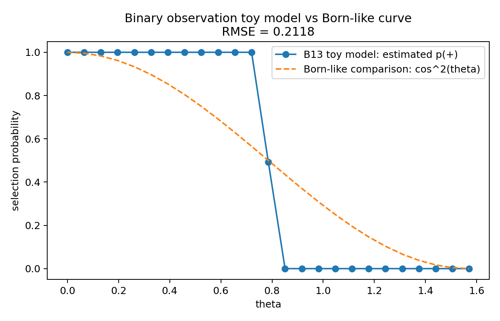
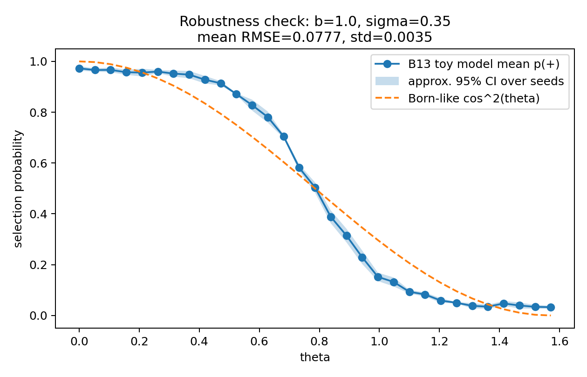

# BIG-B13 — Boundary Folding as a Reduced Model of Observation and Self-Measurement

> **Archive audit, 15 October 2026:** [Version 1.1](https://zenodo.org/records/23392538) is published as one complete ZIP. Eleven manuscript figures use the original Colab PNGs and Figure 3 is replotted from the unchanged saved table; principal numerical results are retained. The public ZIP is byte-identical to the approved archive and all 119 internal SHA256 checksums pass. **基本的に再現可能。独立した再実行監査は未了** — reproduction is supported in principle; independent rerun auditing is not yet complete. [Audit and published correction](../../docs/B13_publication_audit_2026_10_15.md).


> 🇯🇵 **日本語要約**  
> B13では、境界を介した観測者との結合が hidden-depth 状態の選択にどう影響するかを縮約モデルで調べます。基準モデルではBorn-like参照曲線との差が大きい一方、有限ノイズや観測者結合を含む条件では参照曲線に近づく領域が確認され、状態選択が境界結合・ノイズ・内部状態に依存して変化することを示しました。これは量子測定やBorn則の導出ではなく、境界を介した状態選択機構のモデルレベル検査です。

## Purpose

BIG-B13 introduces a reduced observer--system interaction in which boundary overlap couples hidden-depth states and changes state selection.

A compact state notation is

```text
system:   S = (phi, R, h)
observer: O = (Phi, Q, H)
```

with an observation-like coupling of the form

$$
E_{\mathrm{obs}}(S,O)
=
-\lambda_{\mathrm{obs}}\,F_{\mathrm{bdry}}(\phi,\Phi)\,h^T A H.
$$

The numerical experiments examine basin selection, observer directionality, finite noise, and self-observation.

## Representative figures



*Baseline binary-selection diagnostic compared with the Born-like reference used in B13. The comparison is empirical and does not constitute a derivation of the Born rule.*



*Finite-noise robustness diagnostic for the reduced selection model.*

## Scope

The Born-like curves used in B13 are reference comparisons. B13 does **not** derive quantum measurement, the Born rule, the uncertainty principle, consciousness, or AI perception.

## Publication

Current DOI (Version 1.1): https://doi.org/10.5281/zenodo.23392538

Original Version 1 DOI: https://doi.org/10.5281/zenodo.21072783

[Recovered computational source and portable entry point](../../code/B13/README.md).  
[Methods and source clarification](../../docs/B13_methods_and_source_clarification_2026_10_15.md).

Author: Jun Lucis
