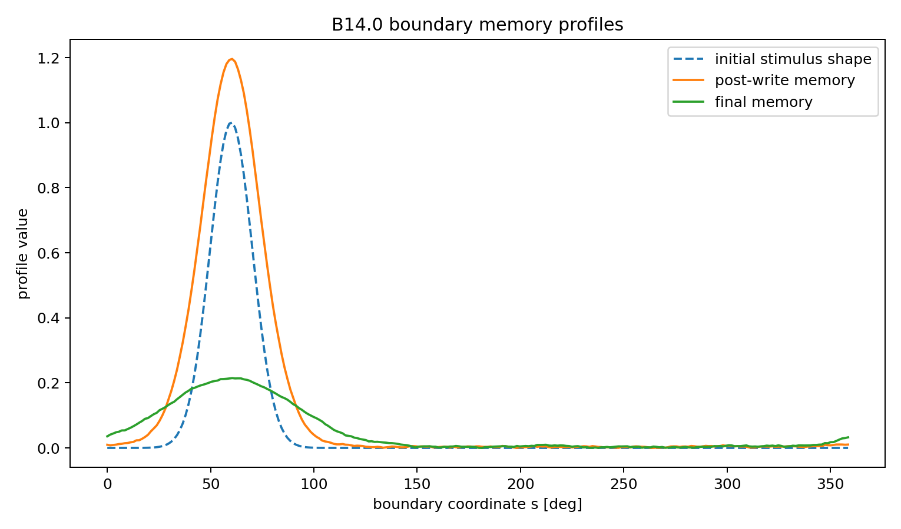

# BIG-B14 — Boundary History and Lineage-Level Persistence

> 🇯🇵 **日本語要約**  
> B14では、過去の相互作用を明示的な「境界履歴」$H_\Sigma$ として状態に加え、局在刺激の書き込み、緩和・忘却、融合時の圧縮、分裂時の分配、世代をまたぐ伝播を縮約演算子として調べます。数値実験では、刺激後にも履歴とのコサイン類似性が残り、分裂を繰り返して個々の強度が減衰しても系譜レベルの履歴構造が保持され得ることを確認しました。ここでの継承は遺伝学の定量モデルではなく、境界に保持される履歴の数理モデルです。

## CP19 archive audit (16 October 2026)

**基本的に再現可能。独立した再実行監査は未了。**

The complete v1.1 ZIP contains the clarified paper, original published materials, all 70 recovered result files, original notebook, portable replay adapter and verification tools. The original numerical outcomes and 19 published image panels are preserved. Saved-data verification passed 165 groups / 36,176 values, including all 1,905 lineage profiles. The previous public package and original data agreed on 329,270 common numeric values. No new stochastic trajectories were generated.

Fusion norm loss is prescribed by the chosen operator; reported profile similarity is uncentered cosine similarity. The zero-noise lineage-mean identity explains part of the persistence in the normalized mean profile and does not establish amplitude conservation. The paper also repairs clipped table columns.

[Methods and scope](../../docs/B14_CP19_METHODS_CLARIFICATIONS.md) · [Audit record](../../docs/B14_CP19_AUDIT_20261016.md) · [Recovered definitions and replay](../../code/B14_recovered)

## Purpose

BIG-B14 adds an explicit boundary-history field to the BIG state and introduces reduced operators for writing, relaxation/forgetting, fusion compression, division partitioning, and lineage propagation.

The central question is whether a localized boundary trace can survive transformation and remain detectable across later generations of the reduced model.

## Representative figure

*Representative boundary-history profiles after localized writing and subsequent evolution in the reduced B14 model.*

## Scope

B14 is a reduced operator model. It is not a quantitative model of biological life, heredity, fertilization, cell division, or genetics.

## Publication

Current version 1.1: https://doi.org/10.5281/zenodo.23400901

Historical v1: https://doi.org/10.5281/zenodo.21144373

Author: Jun Lucis
