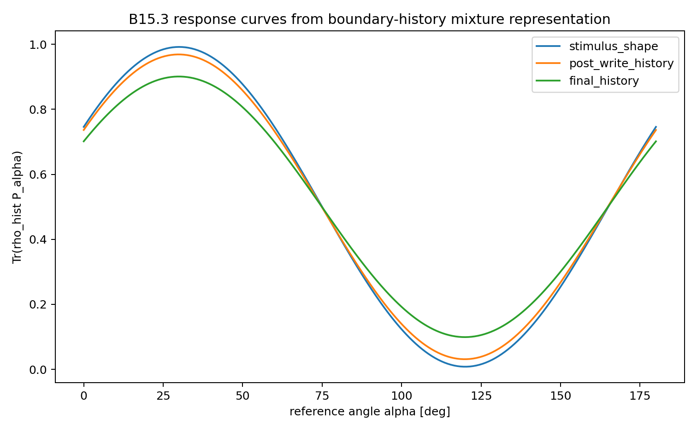
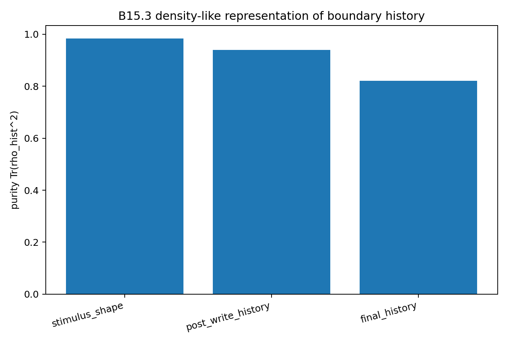

# BIG-B15 — Observation Traces and Boundary History

> 🇯🇵 **日本語要約**  
> B15では、B13/B13.1の状態選択とB14の境界履歴を、共通の演算子表現で接続します。hidden-depth の有限な状態群を density-like mixture として表し、履歴の絶対量と正規化された状態構成を分離して扱うことで、線形・アフィン・非線形・状態依存の更新写像を同じ枠組みで比較できるようにしました。これは量子状態そのものを主張するものではなく、観測痕跡と履歴更新を整理する数学的表現です。

## CP20 archive audit (16 October 2026)

**基本的に再現可能。独立した再実行監査は未了。**

The complete v1.1 ZIP contains the clarified 13-page paper, all 25 original result files, three unchanged original computational notebooks, 36 definitions (32 unique names), the exact B14 history input and a portable replay adapter. Original tables, numerical results, ten published image panels and original diagnostic labels are preserved. Saved-output verification passed 142 groups / 15,935 values. The former public CSVs and original data match on 24,217 common numeric values after an explicit column mapping. No new stochastic trajectories were generated.

The density matrix retains one angular moment and is a lossy representation; purity and concentration are algebraically related. Even the reported scalar amplitudes plus density matrix do not reconstruct arbitrary histories. Kernel RMSE is in-sample, and the saved constrained optimum has an objective-specific convex certificate. B15 illustrative fusion differs from B14's stable operator. The archived “approximately linear” label is a fixed weak-overlap-fixture result; an additional separately identified deterministic input demonstrates nonadditivity elsewhere. The adapter requires the exact B14 input instead of silently substituting toy histories.

[Methods and scope](../../docs/B15_CP20_METHODS_CLARIFICATIONS.md) · [Audit record](../../docs/B15_CP20_AUDIT_20261016.md) · [Recovered definitions and replay](../../code/B15_recovered)

## Purpose

BIG-B15 provides a reduced operator representation connecting B13/B13.1 observation traces with B14 boundary history.

Hidden-depth states can be embedded in a real two-dimensional Hilbert-like representation, while finite state clouds can be represented by density-like mixtures. Boundary-history amplitude is kept distinct from the normalized history representation.

The update maps are compared with linearity and affinity diagnostics on a fixed fixture; original labels are preserved and do not certify all inputs.

## Representative figures

*Response curves in the density-like boundary-history representation.*

*Purity diagnostic for the three archived B14 boundary-history profiles. The density-like representation is mathematical bookkeeping, not a claim of a physical quantum state.*

## Scope

The Hilbert-like and density-like notation is representational. B15 does not derive quantum mechanics, the Born rule, biological memory, heredity, or physical quantum channels.

## Publication

Current version 1.1: https://doi.org/10.5281/zenodo.23401700

Historical v1: https://doi.org/10.5281/zenodo.21173333

Author: Jun Lucis

