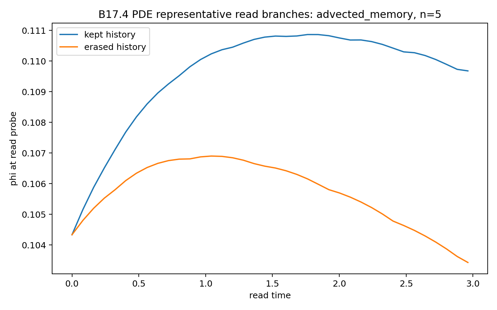

# BIG-B17 — Stored History versus Readable History

> 🇯🇵 **日本語要約**
> B17は、保存された履歴と指定の読出し窓で参照される履歴を比較する縮約モデル研究です。元実装ではB17.1〜.2の読出し位置は実験室座標に固定され、B17.2は同じデータの再解析です。B17.3は境界速度を指定するスカラー応答モデルで、読出し中の忘却項はゼロ。B17.4は各枝の境界に追随する窓を持つ有限格子PDEです。人工的な履歴移動は読出し前までの操作です。元の数値と図を保ち、この違いと標本内適合の範囲をv1.1へ明記しました。

## CP22 status (16 October 2026)

**基本的に再現可能。独立した再実行監査は未了。**

The clarified 13-page English v1.1 manuscript and one complete ZIP are prepared and saved. Zenodo created a new-version draft, but identifier reservation and draft saving failed; reloading returned **502 Bad Gateway / connection closed**. No successful upload or publication was verified. The draft ID is not represented as a registered or published DOI. [Current status](../../docs/B17_CP22/B17_Publication_Status.json).

The original scientific table values, nine figure images, arrays and archived diagnostic labels are preserved. The old Japanese reference remains historical and has not been revised. Five original executed notebooks and all 153 results are recovered: 26 CSVs / 38,454 rows, 12 JSONs, 110 PNGs and five old analysis ZIPs. The four formerly public notebook code-cell sets match their original executed notebooks exactly. B17.0 is retained as ancillary history.

## Model and evidence

The specified local feedback load organizes the archived responses in sample. The B17.1 nonzero-feedback fit retains R² ≈ 0.9940 and correlation ≈ 0.9970. The B17.3 local-load-only fit retains R² ≈ 0.9554, and B17.4 retains R² ≈ 0.9872. These are deterministic training-set summaries. Zero-feedback branch equality follows algebraically from the chosen coupling.

B17.1/2 use a maximum over read [0,2] minus a mean during onset [0,0.2], at a laboratory-fixed site. B17.3/4 use terminal differences at time 3 with branch-specific following windows. A common moving-probe causal explanation is therefore insufficient for the whole sequence. B17.3 prescribes R and evolves a scalar response; its displayed spatial phi profile is diagnostic. The artificial transport controls do not continuously attach history throughout reading.

The PDE history-writing source is pulse-on-gated, without a direct pulse-amplitude multiplier. B17.1 feedback is pointwise in m; B17.4 amplifies the probe using a weighted scalar mean. Both PDE stages have a positive mobility floor and measure an interpolated threshold boundary. Main global-mass-only regressions omit etaS while the local-load predictor includes it. Full-reduced design ranks, including intercept, are 9/10, 11/14 and 12/14 columns across stages 2/3/4, so coefficients do not have unique independent interpretations.

## Reproduction

Original analysis cells and saved trajectory summaries passed 7,670 checks / 22,429 numeric comparisons. Common former-public/original CSVs match on 26,368 numeric values, including nested public ZIPs. All nine selected public figures match original Drive image pixels. Recovery preserves 37 unchanged computational definitions / 27 unique names, in five namespaces. Local stage-2 analysis and plotting from actual B17.1 inputs was tested; the default adapter loads definitions only. Full independent dynamics regeneration has not been completed.

[Methods and implementation](../../docs/B17_CP22_METHODS_CLARIFICATIONS.md) · [Audit record](../../docs/B17_CP22_AUDIT_20261016.md) · [Recovered definitions and local replay](../../code/B17_recovered)

## Representative figure

*Original B17.4 read-branch diagnostic. The artificial transport control shifts history before reading; the read probes follow each branch's current threshold boundary.*

## Scope

This is a reduced model study. It does not establish held-out prediction, a unique empirical memory mechanism, universal boundary laws, continuum convergence, intrinsic surface-history transport, biological learning, neural memory, wound healing, immune adaptation, consciousness or quantum measurement.

## Publication

Current published v1.0: https://zenodo.org/records/22677581

All-version DOI: https://doi.org/10.5281/zenodo.22677580

Clarified v1.1: prepared; publication pending Zenodo service recovery. Original reference DOIs are retained; the GitHub related-work entry is prepared, but its draft save is not confirmed.

Author: Jun Lucis
