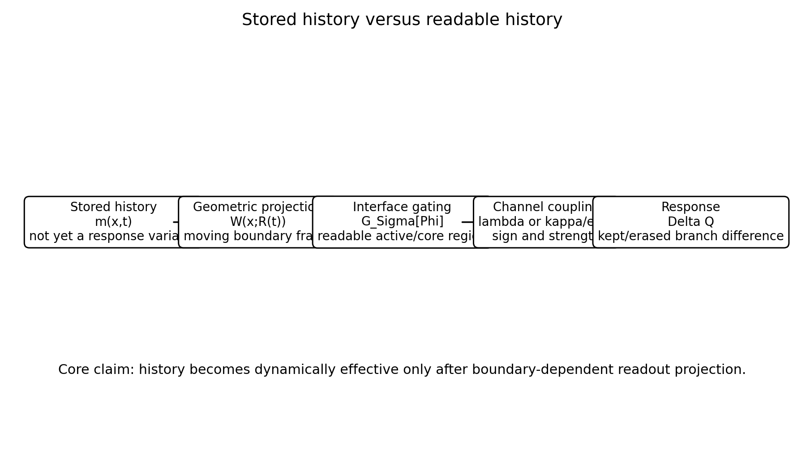

# BIG-B18 — Boundary Readout Operators in Boundary Information Geometry

From Read-Start Local History to Interface-Core Path Exposure in a Reaction-Diffusion-Inspired Front Model

## CP23 clarification, 17 October 2026

The clarified English v0.2 is published at https://zenodo.org/records/23427115 as one complete ZIP. The public redownload is byte-identical to the frozen archive; SHA-256, MD5, CRC and 182 internal hashes pass. The 13-page manuscript preserves three scientific tables and seven image rasters. Five original notebooks, 76 computational definitions and 124 result files are archived. Saved-data analysis passed 604 groups / 314,972 values plus 44 categorical checks. The old public ZIP is authenticated: five notebook code-cell sets, 22 common data files / 495,864 numeric values and seven public PNG rasters match. GitHub and three original Continues DOI references are verified. **Basically reproducible; an independent full rerun audit has not yet been completed.**

🇯🇵 B18は、抑制的な履歴を持つ一次元frontについて、保存履歴を境界付近の経路曝露で要約する診断を比較します。経路変数は実現した応答軌道を使い、R²とgate選択は同じ標本内です。事前予測や独立検証、PDEの厳密な応答法則とは区別します。数値・図を保持し、実装と解釈を明記したv0.2を公開し、公開実物を照合しました。

## Readout proposal and implemented coupling

The diagnostic proposal is

$$\mathcal L_{\mathrm{read}}=\int_{t_0}^{t_1}\lambda(t)\int m(x,t)W(x;R(t))G_\Sigma[\Phi](x,t)\,dx\,dt.$$

The actual inhibitory PDE term is spatially distributed `-kappa * m * max(u*(1-u),0)`. It is not multiplied by the diagnostic W or threshold gate. Each branch's external read drive follows its own front. Kept/erased suppression therefore includes the resulting difference in subsequent forcing positions.

Within the saved grids, selected threshold/interface-core path exposures have stronger in-sample associations with front suppression than the reported read-start and global-mass variables. The path variables use the realized kept-branch front and field, providing response-time information absent from read-start quantities. They are retrospective diagnostics. B18.0/1 share equivalent432-case outcomes and B18.2/3 equivalent1296-case outcomes. Gate selection and15 overlapping slice refits do not provide held-out validation. Global mass means kappa*m_total in B18.1 but unscaled m_total in the other stages.

For the representative condition alpha=.01, kappa=6, rest delay1, read width.35, duration3.2, the original B18.3 threshold raw exposure at sigma=.15 and suppression are(1.119,.909) for one front-anchored write and(1.755,1.325) for three. These original values are retained. B18.2 uses sigma=.10. They are model-specific values, not universal coefficients.

## Representative figure

The hierarchy from stored history to local/path/interface-core exposure is a diagnostic proposal conditional on the model and information timing. It is not a derived response identity.

## Materials and scope

[Audit report](../../docs/B18_CP23_AUDIT_20261016.md) · [Implementation and methods](../../docs/B18_CP23_METHODS_CLARIFICATIONS.md) · [Recovered computational definitions](../../code/B18_recovered/README.md)

The complete archive contains original notebooks/results, the unchanged historical public ZIP with its original PDFs and editable TeX, reconstructed clarified v0.2 TeX and saved-result verification. Original B18.3 plot/package cells are unexecuted and its Drive folder has five CSV/JSON files and no PNG/ZIP; the seven manuscript rasters are now verified against the public PNGs. Supplied and DOI-bearing public Japanese PDFs are both preserved unchanged. Full field trajectories for all cases are not archived.

The model is reduced and exploratory, not a calibrated chemical, material, biological, neural or consciousness model. No PDE existence, uniqueness, convergence or universality result, and no independent full PDE rerun audit, is claimed. Original numerical outcomes and formal diagnostic labels are unchanged.

## Publication

Historical v0.1: https://zenodo.org/records/22690970

Current published v0.2: https://zenodo.org/records/23427115. [Current publication status](../../docs/B18_CP23/B18_Publication_Status.json).

Author: Jun Lucis
