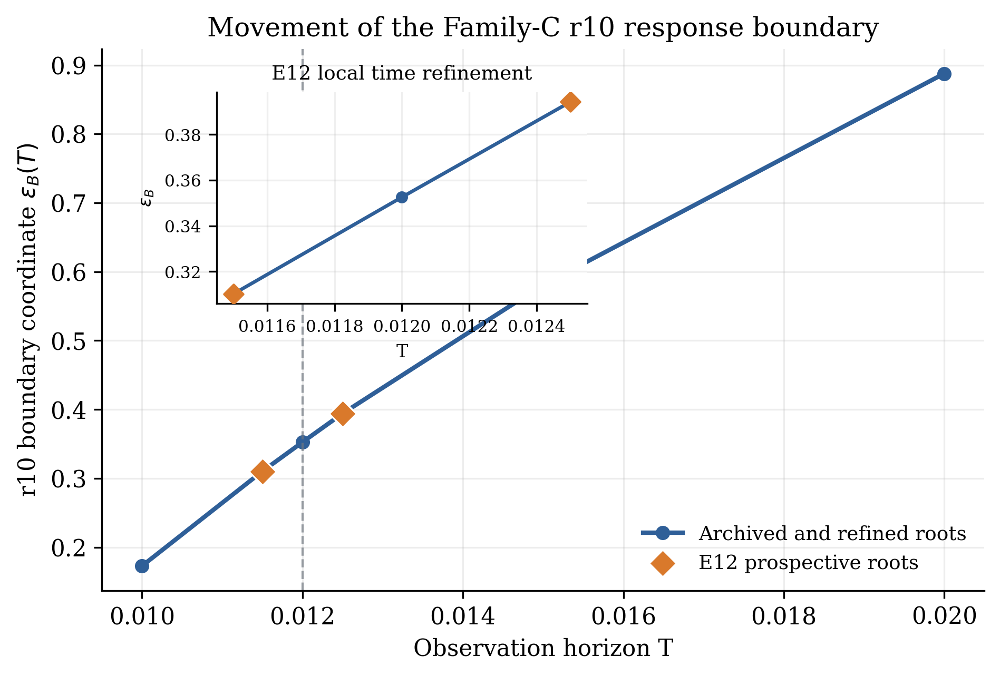
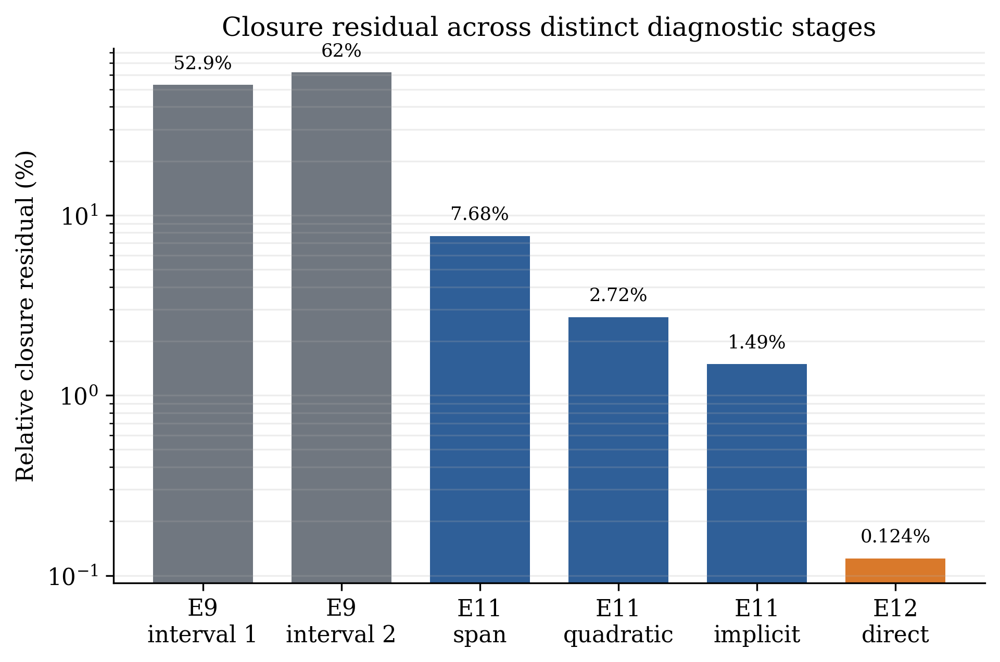
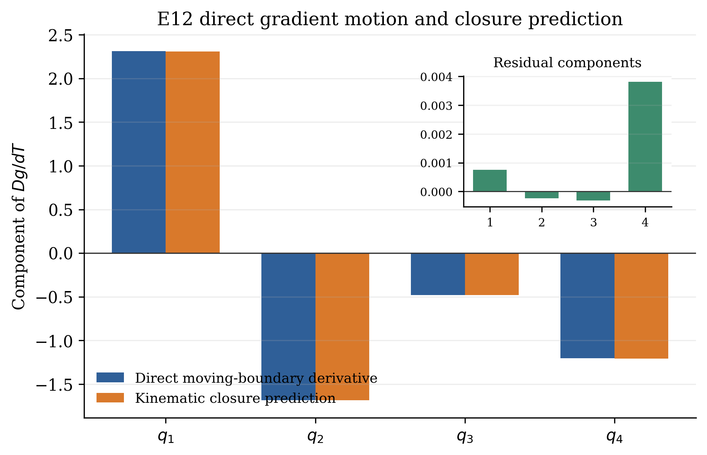

# BIG-B21 — Local Kinematic Closure of Operator-Generated Response Boundaries

*Direct Hessian Transport and Prospective Time Refinement in Synthetic Vorticity Dynamics*

> **CP27 audit in progress — 2026-10-17:** The numerical values and historical study classifications are retained. The uncertainty interpretation and coordinate-precision qualifications below correct the repository description. A revised B21 PDF and complete Zenodo archive have not yet been published. **基本的に再現可能。独立した再実行監査は未了。**

> 🇯🇵 **日本語要約**  
> B21は、B20で定義した有限時間応答境界が観測時間 $T$ とともに動くとき、その局所応答勾配の輸送を検査します。合成Family-Cの `r10` 分枝とB20.5由来の4次元座標構成を使い、$Dg/dT=\partial_Tg+H_S\dot P_B$ を数値的に比較しました。最終E12のclosure residual **0.1242154%**、予測と観測の角度 **0.0698935度**、root bracket由来の一次参考尺度 **0.2174844%** は保持します。ただし、この参考尺度は観測側の勾配変化への伝播量であり、同じ根を使う予測との残差全体の誤差上限として検証された値ではありません。また、初期探索は6桁表示の基底を再直交化し、E10・E12は高精度基底を復元しているため、全段階が厳密に同じ座標であるとは扱いません。当時の有限解像度における限定的判定は維持し、追加項の不在や連続体での閉包を証明したとは解釈しません。B20.6は **INCONCLUSIVE** のままです。

## Purpose

B21 asks a narrower question than B20.6:

> Once a local response-boundary branch is resolved, does the observed time transport of its response gradient close under the ordinary kinematics of a moving level set?

B20 defines

$$
F_T(P)=Z[U_T(P)]-Z[P],
\qquad
\mathcal{B}_T=\{P:F_T(P)=0\}.
$$

In a fixed, normalized four-dimensional subspace $S$, the kinematic relation is written as

$$
g(T,P)=\nabla_S F_T(P)
$$

Along a tracked boundary point $P_B(T)$, the comparison is

```math
\frac{Dg}{dT}=\partial_T g+H_S\dot P_B.
```

where $H_S$ is the subspace Hessian of $F_T$.

The recorded numerical comparison has a precision qualification: the initial E1 exploration reorthogonalizes a six-decimal displayed basis, while E10 and E12 restore the high-precision B20.5 basis. The fixed-parameter E4 temporal gradients inherited by E12 originate in that initial exploration. An independent QR comparison gives a maximum basis-component difference of about $4.12\times10^{-7}$ and a subspace-projector difference of about $6.50\times10^{-7}$ in spectral norm. Both bases are individually orthonormal to floating-point precision, but their frames and subspaces are not exactly identical. No PDE rerun has measured the effect of this difference; the original vectors have not been rotated or replaced.

## Study design

The study uses synthetic Family C on the `r10` branch with:

- $N=48$,
- $L=8$,
- $\nu=0.003$,
- $E_{\max}=30$,
- time-step cap $5\times10^{-5}$.

Experiments E1--E11 are exploratory diagnostics. E12 is the prospectively frozen terminal test. No additional PDE experiment was added after the E12 stopping rule.

## Main numerical findings

- **E10, Hessian-vector convergence:** the two-scale Hessian-vector products have norm ratio **0.9999603**, angle **0.001016 degrees**, and relative difference $4.35\times10^{-5}$.
- **E11, exploratory speed sensitivity:** changing the boundary-speed estimate changes the closure comparison. This diagnostic is not a complete uncertainty budget for the final residual.
- **E12, frozen prospective closure:** using $T_-=0.0115$ and $T_+=0.0125$, the direct boundary speed is **83.96484375**. The closure residual is **0.1242154%**, the prediction--observation angle is **0.0698935 degrees**, and the residual is numerically smaller than the first-order root-bracket reference scale of **0.2174844%**.

The historical finite-resolution classification is retained. The root-bracket reference alone does not establish an uncertainty bound for the closure residual or demonstrate the absence of an additional term.

## Shared-root uncertainty qualification

The reported **0.2174844%** is the first-order scale obtained by propagating root-bracket half-widths into the directly observed gradient change using the central HVP. The same two roots also enter the predicted transport through the measured boundary speed. Their contributions to the residual are correlated.

Writing $a_\pm=\partial g/\partial\epsilon$ at the endpoints and $a_0=\|v_q\|\,\mathrm{HVP}_0$, the first-order root contribution to the residual is

```math
\delta r\simeq\frac{(a_+-a_0)\,\delta\epsilon_+-(a_--a_0)\,\delta\epsilon_-}{\Delta T}.
```

Under the conditional assumption $a_-=a_+=a_0$, the common first-order root contribution cancels in the residual, even though it changes the direct and predicted terms separately. This algebraic example is not a bound on the actual nonlinear residual: endpoint sensitivity variation, higher-order terms, coordinate precision, spatial resolution, time integration, and inner finite-difference errors have not been jointly enclosed.

## Representative figures



**Figure 1:** Local tracking of the resolved response-boundary branch across the tested observation-time window.



**Figure 2:** Historical residual and numerical-reference comparison. The root-bracket scale has the direct-term-only qualification stated above; it does not certify the residual's total uncertainty.



**Figure 3:** Frozen E12 comparison of the directly observed response-gradient transport with the kinematic prediction.

## Relationship to B20

B21 starts from the resolved local `r10` branch using the B20.5 coordinate construction, subject to the precision lineage described above. B20.6 is not repaired or upgraded.

B20.6 remains **INCONCLUSIVE** because its frozen finite-distance scan produced only one informative crossing. B21 instead tests a different, local question: whether response-gradient transport along a resolved branch is explained by the standard moving-level-set kinematics.

## Scope

B21 is a finite-resolution numerical study in a finite synthetic vorticity family and the tested four-dimensional coordinate construction, with the recorded precision qualification.

It does **not** provide:

- a new equation of motion;
- a proof of continuum differentiability or Hessian existence;
- an invariant manifold;
- a physical-space boundary law;
- a universal separatrix;
- a Navier--Stokes blow-up, regularity, or singularity theorem.

No B22 claim or experiment is part of B21.

## Next in the series

[BIG-B22](../B22_prospective_local_geometry) separately extends the programme to finite-resolution curvature, normal rotation, principal directions, and sequential held-out forecasts. Its results and DOI are not part of the B21 evidential record.

## Publication

**Zenodo record and DOI:** https://doi.org/10.5281/zenodo.22876813

The Zenodo link currently identifies the original v1.0 English preprint and its Japanese reference translation. The repository qualifications above are recorded in the [CP27 interim audit](../../docs/B21_CP27_INTERIM_AUDIT_20261017_JA.md); the revised PDF and complete archive remain pending.

The interim audit includes an independent **23-comparison saved-table algebra check** and a basis-lineage diagnostic. These are not a fresh PDE run or completion of the whole-source execution audit.

Repository: https://github.com/Jun-Lucis/BIG-theory

Author: Jun Lucis
