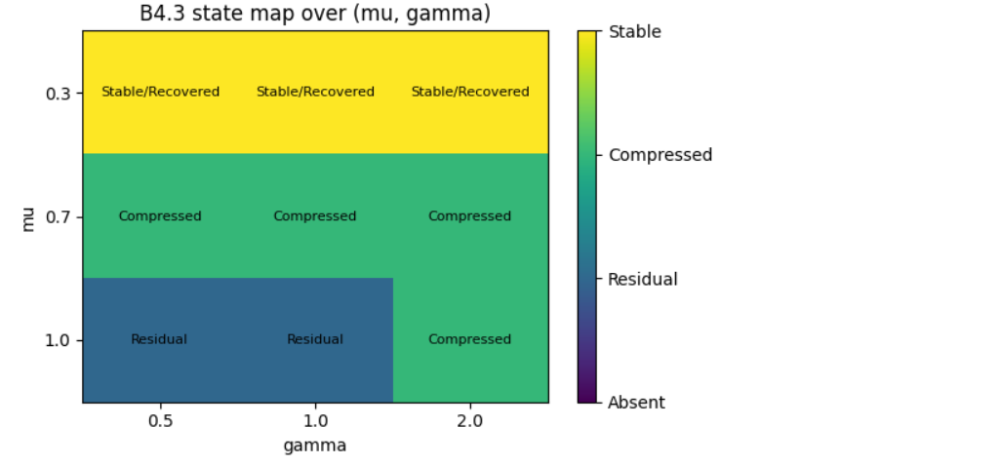

# BIG-B4.3

## Boundary-Layer Stability and Compression under Joint Parameter Variation in Degenerate Mixed-Gradient Dissipative Fields

### Summary

BIG-B4.3 investigates the stability of quadratic boundary layers under simultaneous variation of

- dissipation parameter μ
- quartic-gradient stiffness γ

The study extends BIG-B4.1 from a one-parameter universality scan to a two-parameter boundary-layer map.

### October 2026: printed-equation / numerical-solver clarification

**A source-to-output audit identified a material discrepancy.** The published B4.3 equation prints a **negative** quartic-gradient term (`-gamma div(|grad(phi)|² grad(phi))`), whereas a recovered B4.3 pilot finite-volume solver uses a **positive `+4 gamma`** quartic-gradient face flux. Applying the recovered operator to **six** archived B4.3 fields reproduces residuals near `1e-8`; using the printed `-gamma` in the same stencil gives residuals of approximately `0.0021–0.0103`. The archived pre-update stopping norms are also reconstructed to relative differences below `4e-11`.

These findings **strongly support** the `+4 gamma` solver for the six checked numerical outputs, but do **not** establish the original executed source for B3.1, verify the other three B4.3 raw fields, or prove an exact zero-support boundary. This is a **retrospective clarification**, **not a regrading** of the published numerical classifications.

**[Read the detailed equation/implementation audit and scope of the evidence](../../docs/B4_3_printed_equation_vs_numerical_solver_audit_2026_10.md).** A corresponding clarification for the Zenodo description is recommended; an amended paper PDF would require a separate version.

### Main Observations

- ν ≈ 2 remains robust across all tested parameter regions.
- Boundary-layer width depends strongly on μ.
- Increasing γ improves amplitude consistency.
- Three numerical regimes emerge:
  - Stable / Recovered
  - Compressed
  - Residual

### Key Numerical Findings

| Regime | Characteristics |
|----------|----------|
| Stable / Recovered | Robust ν≈2 and accurate asymptotic amplitude |
| Compressed | Quadratic layer preserved but width reduced |
| Residual | Quadratic signatures remain but amplitude mismatch persists |

### Main Figures

- Effective exponent map
- Boundary-layer width map
- Relative amplitude error map
- Phase-state map (Stable / Compressed / Residual)

### Status

Completed numerical report.

### DOI

### Related Reports

- BIG-B3.1 — Boundary-Layer Scaling and Quadratic Landing
- BIG-B4.1 — Quadratic Boundary Universality Scan

### Representative Figure

